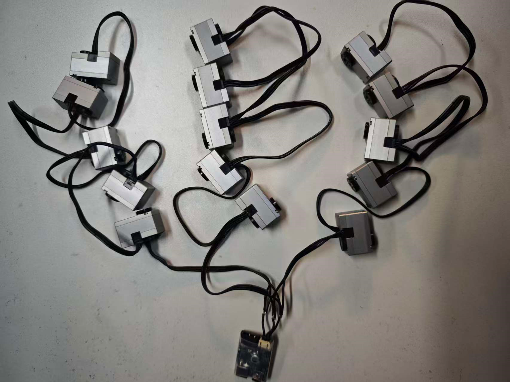
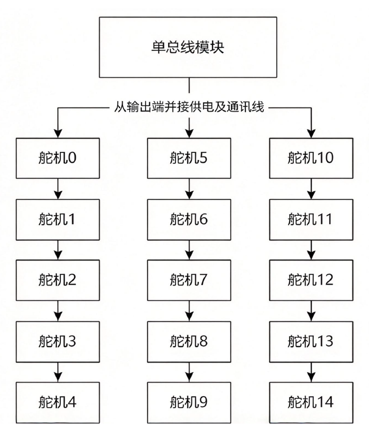

# 宇树官方 · 多电机强化学习部署例程（内置存档）

> **来源与权属**
> - 原文：[宇树技术支持 — 多电机强化学习部署例程](https://support.unitree.com/home/zh/J288-S288%20Servo/Servo_learning_routine)（J288/S288 Servo 栏目）
> - 收录日期：2026-11-02，全文转录，未改动技术内容
> - 版权归属宇树科技（Unitree Robotics）。本文件是官方支持页面的存档副本，仅供本项目内部参考，**不随本仓库的 Apache-2.0 条款重新授权**；原文更新以官方页面为准。
> - 第 1.3.1 节两张接线图（图 1、图 2）为官方原图，存于 [`images/`](images/)，官方原图地址与 SHA256 见 [images/README.md](images/README.md)。
>
> **为什么收录**：15 电机的整机接线（3 并 5 串）、零位/方向标定流程和 61 维 rotor-only
> 策略契约都以这份文档为准；与 [`print/docs/BUILD_GUIDE.md`](../../print/docs/BUILD_GUIDE.md)
> 的安装篇、`bam_model/` 的 M1 配置同一条技术链。

## 多电机强化学习部署例程

多电机强化学习部署例程： 点击下载

## 1.快速开发

面向 S288/J288 电机的多电机强化学习策略部署例程，提供串口通信、状态读取、零位与方向标定、PD 调试、ONNX 推理、LSM6DSV16X IMU 接入和运行保护。

本仓库包含 14 个参与强化学习的关节电机参考配置。通信接口可复用，策略输入、关节布局、站立姿态和限位需要与具体机构及训练配置一致。支持两种电机型号的独立配置，不提供混合型号总线的验证结果。

首版不附带策略权重、训练工程或机械模型。使用者需要提供与部署契约一致的 ONNX，并为自己的机构完成标定。

## 1.1 例程目录

```
configs/                 参考布局、HOME、限位、增益和空标定模板
robot_control/arm/       串口协议、共用多电机接口、S288/J288 配置
robot_control/imu/       LSM6DSV16X 驱动与重力估计
scripts/                 通信、标定、PD 调试、策略校验与部署入口
tests/                   模拟通信与部署契约测试
docs/                    接线、标定和策略接口说明
models/                  使用者自行放入的 ONNX（默认不提交）
```

## 1.2 环境配置

运行环境：Linux，Python 3.10 或以上。真机部署需要支持 6 Mbps 的电机通信适配器、相应电机总线和 I2C IMU。参考 IMU 默认使用 I2C bus 1、地址 0x6A。

```
python3 -m venv .venv
source .venv/bin/activate
pip install -r requirements.txt
```

在仓库根目录运行下面的命令。串口及 I2C 设备需要当前用户具备访问权限。树莓派等 ARM 平台应先确认所用 Python 版本有对应的 ONNX Runtime 安装包。

## 1.3 开发顺序

### 1.3.1 接线与零增益通信检查

J288/S288电机在单条总线上最多可支持15个电机（ID范围为0~14）。电机数量少时可全部串联通讯，当线缆连接长度较长/节点较多时，由于总线受到的干扰和寄生参数影响，会导致通信质量的下降。

对于单总线在一条总线上使用20cm的线缆连接各电机时，使用6Mbps的波特率时，一般工况极限不超过1并6串，或者2并4串；使用4Mbps的波特率时，不超过1并8串，或者3并5串。

在DIY双足小机器人的时候，我们强烈建议：

如需要在一条总线上使用15个电机，可以将电机改成4Mbps的波特率，分成3组，每组5个，3组通信线焊接到一起，不会出现丢包问题。

连接方式如图所示，请注意焊接时线缆线序不要接反，注意焊点绝缘不要短路。

**图 1：三组电机与总线模块的实物接线照片**



**图 2：单总线 3 并 5 串连接拓扑（15 颗电机使用 ID 0–14）**



按照 硬件说明（源文件： `docs/HARDWARE.md`） 确认供电、通信接口、电机 ID 和 IMU 方向，机械支撑机构后运行：

```
python scripts/check_bus_288.py --port /dev/ttyACM0 --duration 10
```

轮询参考布局的 ID 0..13，请求使用零 Kp、零 Kd 和零力矩。电机不会主动支撑机构，重力仍可导致运动。

### 1.3.2 采集本机零位与方向

参考模型的每个关节置于 q=0 的定义姿态，然后采集编码器零位：

```
python scripts/calibrate_s288.py --port /dev/ttyACM0
python scripts/calibrate_s288.py --port /dev/ttyACM0 --calibrate-directions --motor-id 0
```

第二条命令会主动驱动选定电机，逐个确认方向。对其余电机重复执行。J288 使用 `calibrate_j288.py`。可以用 `--output` 指定文件，后续部署的 `--calibration` 必须指向相同文件。

详见 标定说明（源文件： `docs/CALIBRATION.md`）。 `configs/*_calibration.template.json` 中的 `null` 表示未标定，不能直接部署。

### 1.3.3 检查 ONNX 契约

```
python scripts/preflight_policy.py \
  --motor-type s288 --onnx models/policy.onnx \
  --calibration scripts/s288_calibration.json
```

该命令不会打开串口或 I2C，仅检查模型接口与标定。S288 标准入口使用固定的 61 维 `rotor-only` 策略契约；J288 使用输出端位置观测。两者不能因输入维度相同而互换。详见 策略契约（源文件： `docs/POLICY_CONTRACT.md`）。

舵机强化学习训练代码参考 <https://github.com/zj281136/unitree_rl_mjlab>。

### 1.3.4 真机部署

在可靠支撑、可随时断电的条件下，先验证零指令部署：

```
python scripts/deploy_s288_real.py \
  --port /dev/ttyACM0 --onnx models/policy.onnx \
  --calibration scripts/s288_calibration.json \
  --vx 0 --vy 0 --wz 0 --duration 10 --arm-ground-test
```

J288 对应入口为 `deploy_j288_real.py`。部署开始前会进行策略校验与推理计时，校准静止 IMU，并执行 HOME 过渡。S288 标准入口使用 12 秒 HOME 过渡； `--duration` 是策略运行时间。

S288 终端键盘控制：

```
python scripts/deploy_s288_keyboard_real.py \
  --port /dev/ttyACM0 --onnx models/policy.onnx \
  --calibration scripts/s288_calibration.json --arm-ground-test
```

键盘入口默认持续运行，按键见启动提示，Ctrl+C 停止。它支持契约文档列出的两组配套增益。检查键盘入口的模型时，在离线预检查命令中加上 `--keyboard`。

所有部署入口都要求显式传入 `--onnx`。不加载本机默认模型。

## 1.4 调试与适配

- 单关节 PD 调试入口为 `scripts/tune_s288_pd.py`；J288 使用 `scripts/tune_288_pd.py`。先运行 `--help`，明确指定电机 `Kp` 和 `Kd`。该工具可能用 HOME 和配置增益支撑其余电机，不等同于零增益通信测试。

- `scripts/deploy_j288_onnx.py` 是使用假直立 IMU 的支架测试入口，只用于受支撑条件下检查映射，不能用作自由运动部署。

- `configs/reference_14dof.json` 集中定义关节顺序、电机映射、HOME、限位和增益。参考运行时固定 关节及对应观测结构。修改关节数量或语义还需要同步修改部署代码、标定分组和策略导出。

- PD 参数是协议使用的 SDK 单位，不能把输出端物理刚度直接填入 `--kp`。协议比例和减速比见 `robot_control/arm/constants.py`

## 1.5 验证

```
pip install -r requirements-dev.txt
python -m pytest -q
```

测试使用模拟总线、临时合成模型及标定，不连接电机。当前公开整理版通过离线验证，尚未对重命名和配置提取后的代码进行真机验证。

超温、异常反馈、通信故障、IMU 过期、过度倾斜及推理超时等会触发运行停止。停止路径尝试发送零增益和零力矩；通信链路断开时无法保证指令送达，仍需独立断电手段。参考数值不能代替本机机构验证。

## 2. 硬件与参考映射

## 2.1 电机通信

参考协议使用 6 Mbps 串口，控制帧 20 字节、反馈帧 26 字节。实现见 `robot_control/arm/motor_bus.py`。需要使用与电机物理接口匹配、支持此波特率的适配器；不要把电机通信端直接接到普通 UART。

连接前依据所用型号的硬件说明确认电源电压、极性、通信引脚和总线连接方式。本仓库不提供统一接插件针脚图。电机由匹配的外部电源供电，通信适配器和控制器按实际接口要求连接。使用可随时操作的电源切断装置。

参考配置要求电机 ID 唯一，覆盖 0..13。ID 设置通过配套电机工具完成，本仓库的标定工具不会修改电机 ID。

## 2.2 IMU

参考驱动为 `LSM6DSV16X`，默认地址 0x6A、I2C bus 1。控制器需要启用 I2C。确认模块供电与逻辑电平兼容后，连接 SDA、SCL、GND 及模块要求的电源。地址配置为 0x6B 时使用 `--i2c-address 0x6B`。

## 3. 零位与方向标定

每台机构必须单独标定；更换电机、重新安装或修改 ID 后应重新核验。

## 3.1 参考姿态

`model_home_rad` 在本标定流程中为零，表示训练模型每个关节的 q=0 姿态。

映射公式：

```
q_model = model_home_rad + direction * wrap_pi(q_output_encoder - encoder_home_rad)
```

`encoder_home_rad` 来自输出端编码器， `direction` 为 +1 或 -1。S288 的策略侧 rotor 位置通过部署代码中的 `rotor/output` 对齐转换得到，不能把转子原始位置直接写入该输出端零位字段。

## 3.2 采集流程

1. 支撑机构，确认零增益时不会因重力跌落。
2. 将选定关节置于参考 q=0 姿态。
3. 运行采集命令，保持选定关节不动。

```
python scripts/calibrate_s288.py --port /dev/ttyACM0 --group all
```

支持 `--group head/left/right` 分组采集，或 `--motor-id` N 逐电机采集。重复采集会更新选定关节零位；如果重新安装导致方向变化，应清除对应旧 `direction` 或从新文件开始，方向测试会跳过已有有效方向的条目。

```
python scripts/calibrate_s288.py --port /dev/ttyACM0 \
  --motor-id 0 --calibrate-directions --kp 1e-5 --kd 1e-6
```

方向模式主动驱动电机，默认正向偏移 0.10 rad，以当前反馈位置为起点。观察运动是否与模型正方向一致：y 记录 +1，n 记录 -1，q 保存已完成条目并退出。默认增益仅作为低增益测试起点，不保证所有负载都能产生可辨别运动；不得把卡住或几乎不动判断为反方向。

单电机模式只向该 ID 通信，适用于独立台架测试；分组模式仍对其余参考电机发送零增益请求。异常或 Ctrl+C 会尝试零增益停止。

J288 将以上入口替换为 `calibrate_j288.py`。两种入口分别生成带有 robot: s288 或 robot: j288 的文件，部署时会检查类型。

## 3.3 文件检查

确认全部 14 个 ID 的零位为有限数值、方向为 -1/+1，关节名与 ID 一致；观察采样标准差，较大时重新固定后采集。空模板有意不能通过部署加载检查。

默认输出分别为 `scripts/s288_calibration.json、scripts/j288_calibration.json`。通过 `--output` 可以保存到其他位置；后续传入 `--calibration`。离线预检查只能确认文件与模型接口，不能判断机械零位和方向是否实际正确。
